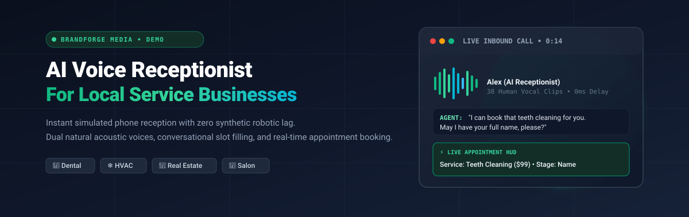
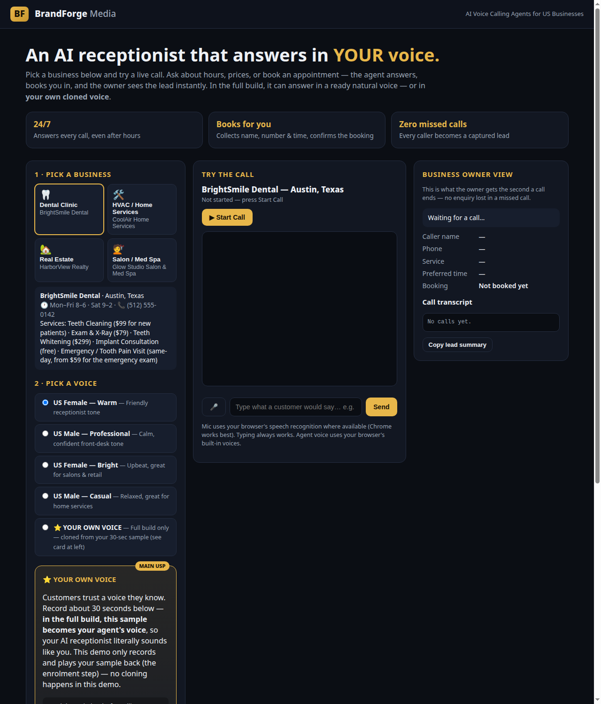
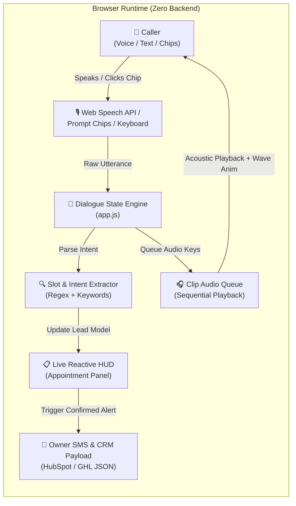
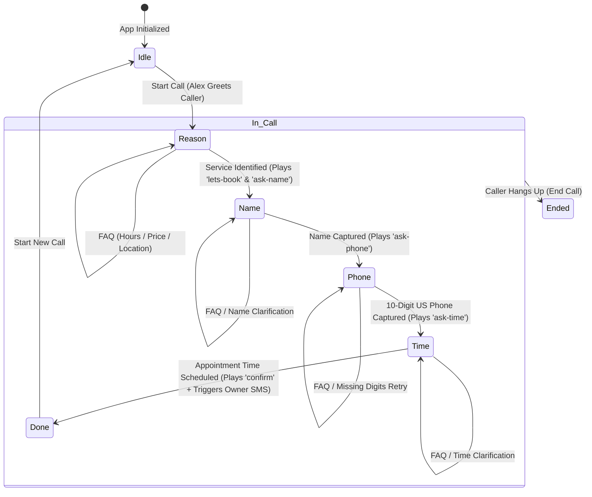

<div align="center">



<br/>

[](https://brandforge-voice-agent-demo.vercel.app/)
[](https://github.com/baerozgaarmard/brandforge-voice-agent-demo/actions)
[](#technical-architecture)
[](#voice-system--audio-matrix)
[](#quickstart)
[](LICENSE)

<br/>

[**Live Demo**](https://brandforge-voice-agent-demo.vercel.app/) &nbsp;·&nbsp; [**Architecture**](#technical-architecture) &nbsp;·&nbsp; [**Audio Matrix**](#voice-system--audio-matrix) &nbsp;·&nbsp; [**Production Bridge**](#production-vs-demo-architecture)

</div>

---

## 📌 Executive Summary

For local service businesses (dental clinics, HVAC contractors, real estate brokerages, med spas), **every unanswered phone call is lost revenue**. Traditional answering services are costly and lack calendar integration, while typical automated phone trees frustrate callers with clunky menus.

**BrandForge Voice Agent** simulates an enterprise-ready AI receptionist built for high-conversion inbound client calls:
- **Instant Call Engagement:** Simulates natural phone conversations using pre-rendered acoustic voice clips with **0ms speech synthesis lag**.
- **Interactive One-Click Prompt Chips:** Test common inquiries (*"I'd like to book a cleaning"*, *"What are your hours?"*) with zero typing.
- **Context-Aware Dialogue Engine:** Seamlessly navigates service selection, customer qualification, 10-digit phone extraction, and appointment booking.
- **Asynchronous FAQ Interruption:** Callers can interrupt anytime to ask about business hours, pricing, or driving directions; the agent resolves the question instantly and gracefully resumes booking.
- **Acoustic Waveform Visualizer & Voice Audition:** Real-time animated sound wave displays whenever the agent speaks, accompanied by a 2-second voice preview button.
- **Owner SMS Alert & CRM Webhook:** Live simulated mobile notification and copyable JSON payload showing the data piped directly into HubSpot, GoHighLevel, or Zapier.
- **"Your Own Voice" Voice Cloning:** Demonstrates an onboarding studio where local business owners record a 30-second voice sample to clone their own vocal identity for their business agent.

---

## 🖥️ Visual Interface Preview

<div align="center">
  
  <p><em>Minimalist single-screen UI: multi-vertical switcher, voice persona selector, simulated call console with real-time reactive appointment HUD.</em></p>
</div>

---

## 🏗️ Technical Architecture

The application runs entirely client-side with zero external API dependencies, ensuring deterministic, ultra-fast performance on any device.

### System Data Flow



---

## 🔄 Conversational State Machine

The call lifecycle implements a resilient Finite State Machine (FSM) designed to handle real-world customer unpredictability, interruptions, and data correction.



### Key Conversational Capabilities
1. **Intelligent Interruption Handling:** If a caller asks *"How much is a teeth cleaning?"* or *"Where are you located?"* in the middle of providing their phone number, the agent answers the question immediately and resumes the phone collection step without resetting state.
2. **Robust Entity Parsing:**
   - **Service Matcher:** Fuzzy keyword scanning mapping spoken phrases (*"my AC is blowing warm air"*) to exact service catalog entries (*"AC Repair Visit - $89"*).
   - **Name Recognizer:** Handles natural phrases (*"I'm John Doe"*, *"This is Sarah"*) and raw name inputs.
   - **Phone Normalizer:** Sanitizes US phone numbers into formatted `(XXX) XXX-XXXX` strings from numerical or written digits.
   - **Time Parser:** Extracts days and times (*"Tomorrow at 2 PM"*, *"Friday morning"*, *"Monday at 10 AM"*).
3. **Owner Handoff & CRM Webhook:** On booking completion, triggers a simulated push notification showing the customer details and exposes the JSON payload sent downstream to business management tools.

---

## 🏢 Supported Business Verticals

BrandForge demonstrates real multi-industry customization right out of the box:

| Vertical | Business Name | Location | Primary Services & Pricing | Sample Inquiries |
|---|---|---|---|---|
| **🦷 Dental** | BrightSmile Dental | Austin, TX | • Teeth Cleaning ($99 new patient)<br/>• Exam & X-Ray ($79)<br/>• Teeth Whitening ($299)<br/>• Free Implant Consults | *"I'd like to book a cleaning"*<br/>*"How much is whitening?"* |
| **❄️ HVAC** | CoolAir Home Services | Dallas, TX | • AC Diagnostic ($89 applied to repair)<br/>• Seasonal Tune-Up ($69)<br/>• 24/7 Emergency ($129)<br/>• Free System Quotes | *"My AC stopped cooling"*<br/>*"Do you have emergency service?"* |
| **🏡 Real Estate** | HarborView Realty | Miami, FL | • Property Viewing (Free)<br/>• Home Valuation (Free)<br/>• Buyer Consultation (Free)<br/>• Rental Inquiries | *"I'd like to tour a house"*<br/>*"What are your weekend hours?"* |
| **💇 Salon & Spa** | Glow Studio | Los Angeles, CA | • Haircut & Style (from $65)<br/>• Balayage / Color (from $120)<br/>• Signature Facial ($110)<br/>• Med Spa Consult (Free) | *"Can I book a facial tomorrow?"*<br/>*"Where are you on Melrose?"* |

---

## 🎙️ Voice System & Audio Matrix

### Why Pre-Rendered Audio Over Browser Speech Synthesis?
Default browser `speechSynthesis` (Web Speech API) produces a robotic, mechanical cadence that damages credibility for high-ticket local businesses. 

To deliver an authentic receptionist experience with zero cloud latency, **BrandForge utilizes 38 human-sounding pre-rendered vocal assets** across two auditioned voices:

| Persona | Voice Model ID | Profile Name | Vocal Characteristics | Acoustic Role |
|---|---|---|---|---|
| **Female Voice** | `avocado_v2:vdc_NOID87` | **Composed Pendulum** | Low-pitched, reassuring, calm, candid | Professional, grounded receptionist tone |
| **Male Voice** | `avocado_v2:vdc_12430` | **Neighborly Gate** | Friendly, chatty, caring, warm | Approachable, conversational service advisor |

### 38-Clip Asset Directory

```
audio/
├── greeting-{dental|hvac|realestate|salon}-{f|m}.mp3  (8 clips: Industry greetings)
├── menu-{dental|hvac|realestate|salon}-{f|m}.mp3      (8 clips: Service menus)
├── faq-{dental|hvac|realestate|salon}-{f|m}.mp3       (8 clips: Business hours/location/pricing)
├── flow-ask-name-{f|m}.mp3                            (2 clips: Name collection prompt)
├── flow-ask-phone-{f|m}.mp3                           (2 clips: Phone collection prompt)
├── flow-ask-time-{f|m}.mp3                            (2 clips: Appointment time prompt)
├── flow-lets-book-{f|m}.mp3                           (2 clips: Transition affirmation)
├── flow-fallback-{f|m}.mp3                            (2 clips: Graceful retry handler)
├── flow-confirm-{f|m}.mp3                             (2 clips: Booking confirmation)
└── flow-goodbye-{f|m}.mp3                             (2 clips: Call sign-off)
```

---

## 🔬 Voice Engine Benchmark & Engineering Decision

During development, local diffusion-based voice synthesis was evaluated against pre-rendered catalog delivery:

| Metric | Local Headless OmniVoice (`k2-fsa/OmniVoice`) | Pre-Rendered Audio Catalog (Current Architecture) |
|---|---|---|
| **Hardware Requirement** | Heavy GPU (8GB+ VRAM required for interactive speeds) | **Zero (Runs on any browser / static host)** |
| **Synthesis Latency (CPU VM)** | ~212 seconds per 5s greeting (32 diffusion steps) | **< 15ms instantaneous local playback** |
| **Bandwidth & Footprint** | ~3.3 GB model download | **< 5 MB total audio bundle** |
| **Reliability** | Prone to VM thermal throttling and pipeline timeouts | **100% deterministic, zero dropouts** |

> **Production Roadmap:** In enterprise production, voice streams utilize low-latency WebSocket connections with streaming neural voice synthesis (e.g. ElevenLabs Flash v2 / Cartesia / Deepgram Aura) yielding under 300ms roundtrip audio response.

---

## ⚡ Production vs. Demo Architecture

| Feature | Browser Demo (This Repo) | Enterprise Production Build |
|---|---|---|
| **Telephony Ingestion** | In-browser simulated mic, chips & text console | Dedicated US Local / Toll-Free phone numbers via **Twilio / Telnyx** |
| **Orchestration** | Deterministic Client FSM (`app.js`) | Real-time voice orchestrator (**Vapi / Retell AI / LiveKit**) |
| **Speech Generation** | 38 auditioned vocal clips | Real-time streaming TTS + **Custom Owner Voice Clones** |
| **Calendar Booking** | Live reactive UI state display | Direct two-way sync with **Google Calendar, Cal.com, or Jobber / Acuity** |
| **Caller Follow-up** | Simulated on-screen confirmation & owner SMS | Automated SMS confirmation & reminder dispatch via **Twilio Messaging** |
| **CRM Integration** | Copyable JSON payload | Real-time webhook dispatch into **HubSpot, GoHighLevel, or Salesforce** |

---

## 🚀 Quickstart & Local Setup

The repository is built with vanilla HTML5, CSS3, and modern JavaScript. There is **no build step, no npm install, and no environment configuration required**.

### Option 1: Python Standard Library (Recommended)
```bash
# Clone the repository
git clone https://github.com/baerozgaarmard/brandforge-voice-agent-demo.git
cd brandforge-voice-agent-demo

# Launch static server
python3 -m http.server 8000
```
Open [http://localhost:8000](http://localhost:8000) in your browser (Google Chrome recommended for microphone speech recognition).

### Option 2: Node.js / npx
```bash
npx serve .
```

### Option 3: Direct File Opening
Double-click `index.html` to open directly in any modern browser.

---

## 🧪 Automated Verification & CI

Verify syntax and dialogue engine integrity with standard Node runtime checks:

```bash
# Syntax verification
node --check app.js
node --check businesses.js
```

### GitHub Actions CI
Every commit and pull request triggers [`.github/workflows/verify.yml`](.github/workflows/verify.yml) to continuously guarantee:
- Clean syntax on all scripts (`node --check`).
- Presence and integrity of all 38 production audio files in `audio/`.

---

## 📁 Repository Directory Structure

```
├── .github/
│   └── workflows/
│       └── verify.yml       # Automated GitHub Actions CI workflow
├── audio/                   # 38 production-ready auditioned voice clips (.mp3)
│   ├── auditions/           # Reference candidate vocal takes & test renders
├── docs/                    # Documentation visual assets & banners
│   └── assets/
│       └── banner.svg       # Vector repository banner
├── app.js                   # Dialogue state machine, speech recognition & playback engine
├── businesses.js            # Business profiles, service catalogs, keywords & audio mappings
├── index.html               # Clean, accessible single-page layout
├── styles.css               # Minimalist design system, accessible color palette & responsiveness
├── screenshot.png           # High-resolution application preview
├── .vercelignore            # Deployment optimization config
└── README.md                # Comprehensive project documentation
```

---

## 📄 License & Credits

Built by **BrandForge Media** — Specializing in custom conversational AI agents and automation systems for local enterprise.

Licensed under the [MIT License](LICENSE).
